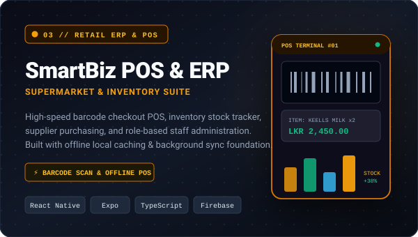
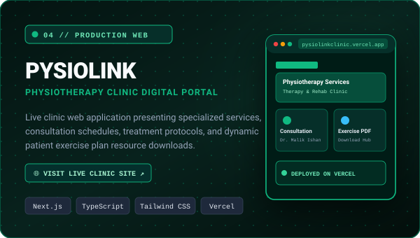

  

  
  
  

## Behind the code

<picture>
  <source media="(max-width: 600px)" srcset="assets/about-mobile.svg">
  
</picture>

<b>About me</b> — readable text version

I'm **Malindu Oshan**, a software developer from **Sri Lanka**, studying **Bachelor of Information Technology** (2023–2026) and **Bachelor of Business Science** (2022–2026) at the **University of Moratuwa**.

I combine software development with business understanding to build practical tools. I've also worked as a **freelance developer and digital services specialist on Fiverr since 2020**, delivering websites, mobile apps, video editing, Excel tasks, and design work for international clients.

Currently learning **cybersecurity** · Certifications: **CCNA Routing & Switching**, **Cisco CyberOps** (Networking Academy) · Hobby: **chess** ♟️

## Selected projects

Some projects are still under development, so each card shows an honest status.

<table>
<tr>
<td width="50%" valign="top">

<h3><a href="https://github.com/malinduoshan/phishguard-phishing-detector">PhishGuard</a></h3>

A cybersecurity mobile app that checks website links for phishing threats and raises user awareness.

<b>Implemented:</b> URL scanning and threat checking · VirusTotal API via a Cloudflare Worker · URLhaus threat intelligence · Firebase Authentication/Firestore · RSS2JSON security news · EmailJS feedback

<b>React Native · Expo · TypeScript · Firebase · Cloudflare Workers</b>

</td>
<td width="50%" valign="top">

<h3><a href="https://github.com/malinduoshan/physiogo-clinic-management">PhysioGo</a></h3>

A mobile app for physiotherapy clinic appointments and workflow, designed to grow into a fuller clinic management solution.

<b>Implemented:</b> appointment booking interface · clinic-focused mobile UI · physiotherapy service workflow <b>Status:</b> in development

<b>React Native · Expo · TypeScript · JavaScript</b>

</td>
</tr>
<tr>
<td width="50%" valign="top">

<h3><a href="https://github.com/malinduoshan/smartbiz-pos-erp">SmartBiz POS &amp; ERP</a></h3>

A POS, inventory, and business management platform for supermarkets, grocery shops, and other retail businesses.

<b>Implemented / in progress:</b> cashier POS with barcode sales · products, inventory, stock movements · customers, staff, role-based access · purchasing and suppliers · reports and dashboard · bulk import/export · offline and sync foundation · printer and cash drawer foundation <b>Status:</b> core work and automated tests in progress; production deployment and subscription enforcement not yet verified

<b>React Native · Expo · TypeScript · Firebase · AsyncStorage</b>

</td>
<td width="50%" valign="top">

<h3><a href="https://pysiolinkclinic.vercel.app/">PYSIOLINK</a></h3>

A website for a physiotherapy clinic presenting its services and appointment-related information, related to PhysioGo.

<b>Includes:</b> clinic information and services · exercise plan PDF resource <b>Scope:</b> informational website (no patient database or clinic backend)

<a href="https://pysiolinkclinic.vercel.app/">Visit website ↗</a>

</td>
</tr>
</table>

## My toolkit

  

  <b>Mobile</b> · React Native / Expo 
  <b>Backend &amp; Data</b> · Node.js / Firebase / MongoDB / MySQL 
  <b>Security &amp; Networking</b> · Threat intelligence APIs / CCNA / CyberOps

## What I'm focused on

- Learning cybersecurity and applying it in real tools.
- Building practical software for clinics, retail, and everyday users.
- Taking projects from prototype toward verified, reliable deployment.

### Let's build something useful.

**[Email](mailto:malinduoshan177@gmail.com)** · **[LinkedIn](https://www.linkedin.com/in/malindu-oshan-b6a38924b/)** · **[Portfolio](https://malinduoshan.github.io/Malindu/)**

## Contribution arcade

<picture>
  <source media="(prefers-color-scheme: dark)" srcset="https://raw.githubusercontent.com/malinduoshan/malinduoshan/output/github-snake-dark.svg">
  
</picture>

Refreshed every 12 hours.

