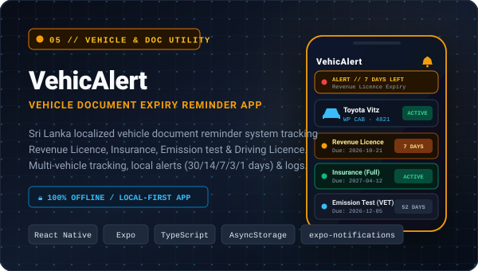
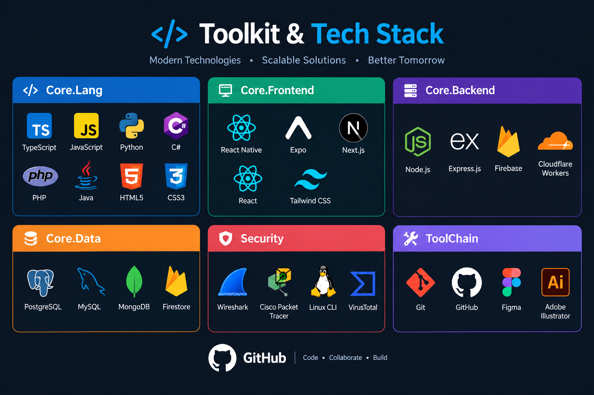

  

  
  
  

## Behind the code

  

<b>About me</b> — readable text version

Final-year **Bachelor of Information Technology (BIT)** undergraduate at the **University of Moratuwa**, bridging scalable full-stack software development with defensive cybersecurity and network operations.

Rather than treating software engineering and security as separate silos, I build secure, high-performance web applications while applying core principles of network defense, vulnerability assessment, and threat detection. In addition to academic coursework and projects, I operate an active freelance solutions service on Fiverr, delivering technical solutions to international clients with an emphasis on production-ready quality and clear communication.

### Core technical competencies

- **Cybersecurity &amp; SOC:** Threat monitoring, incident handling, network defense, vulnerability assessment, SIEM principles, packet analysis with Wireshark
- **Software engineering:** Modern web applications with Next.js, React, Node.js, and Python; secure REST APIs; PostgreSQL, MongoDB, and Firebase
- **Networking &amp; infrastructure:** Enterprise routing and switching, TCP/IP, ACLs, Linux system administration, Cisco Packet Tracer

### Key credentials

- **Cisco CyberOps Associate** — Cisco Networking Academy (issued November 2025)
- **CCNA: Enterprise Networking, Security, and Automation** — Cisco Networking Academy (issued November 2025)
- **(ISC)² Candidate** — ISC2
- **Bachelor of Information Technology (BIT)** — University of Moratuwa (reading)

### Career objective &amp; availability

Completing final degree requirements in late 2026. Actively seeking **Junior Software Engineer, Associate Cybersecurity Analyst, or SOC Analyst** opportunities starting December 2026.

### Work preferences

Open to on-site or hybrid opportunities in Sri Lanka, international relocation to Singapore, the UAE, or the UK, and global remote roles.

### Contact

Feel free to connect on [LinkedIn](https://www.linkedin.com/in/malindu-oshan-b6a38924b/) or reach out directly at [malinduoshan177@gmail.com](mailto:malinduoshan177@gmail.com).

**Hobby:** Chess ♟️

## Featured Engineering Projects

<i>Mission-critical software, defensive cybersecurity systems, healthcare workflows, and local-first utilities.</i>

<table width="100%" border="0" cellspacing="12" cellpadding="0">
<tr>
<td width="50%" valign="top">

<a href="https://github.com/malinduoshan/phishguard-phishing-detector"><b>Explore Repository ↗</b></a>

</td>
<td width="50%" valign="top">

<a href="https://github.com/malinduoshan/physiogo-clinic-management"><b>Explore Repository ↗</b></a>

</td>
</tr>
<tr>
<td width="50%" valign="top">

<a href="https://github.com/malinduoshan/smartbiz-pos-erp"><b>Explore Repository ↗</b></a>

</td>
<td width="50%" valign="top">

<a href="https://pysiolinkclinic.vercel.app/"><b>Visit Live Site ↗</b></a>

</td>
</tr>
<tr>
<td colspan="2" align="center" valign="top">

  <a href="https://malinduoshan.github.io/Malindu/#modalVehicAlertDemo" target="_blank"><b>Watch Demo</b></a> &nbsp;•&nbsp; 
  <a href="https://github.com/MalinduOshan/VehicAlert"><b>Explore Repository ↗</b></a>

</td>
</tr>
</table>

### Enterprise Network &amp; Security Lab

A defensive infrastructure lab simulating multi-branch networking with VLAN segmentation, OSPF routing, perimeter ACL filtering, and packet-level inspection.

**Stack:** Cisco Packet Tracer · Wireshark · Linux CLI · CCNA/CyberOps principles

## My toolkit

  

  <b>Core Languages</b> · TypeScript, JavaScript, Python, C#, PHP, Java, HTML5, CSS3 
  <b>Frontend</b> · React Native, Expo, Next.js, React, Tailwind CSS 
  <b>Backend</b> · Node.js, Express.js, Firebase, Cloudflare Workers 
  <b>Databases</b> · PostgreSQL, MySQL, MongoDB, Firestore 
  <b>Security</b> · Wireshark, Cisco Packet Tracer, Linux CLI, VirusTotal 
  <b>Toolchain</b> · Git, GitHub, Figma, Adobe Illustrator

## What I'm focused on

- Building practical software with secure APIs, validation, and reliable data flows.
- Applying defensive security and threat intelligence principles to real products.
- Preparing for Associate Cybersecurity Analyst and SOC opportunities.

### Let's build something useful.

**[Email](mailto:malinduoshan177@gmail.com)** · **[LinkedIn](https://www.linkedin.com/in/malindu-oshan-b6a38924b/)** · **[GitHub](https://github.com/malinduoshan)** · **[Portfolio](https://malinduoshan.github.io/Malindu/)** · **[Blog](https://traveleasesrilanka.blogspot.com/)**

Built with curiosity. Secured with care. Made in Sri Lanka. 🇱🇰

## Contribution arcade

<picture>
  <source media="(prefers-color-scheme: dark)" srcset="https://raw.githubusercontent.com/malinduoshan/malinduoshan/output/github-snake-dark.svg">
  
</picture>

My contribution graph, in motion · refreshed every 12 hours.

