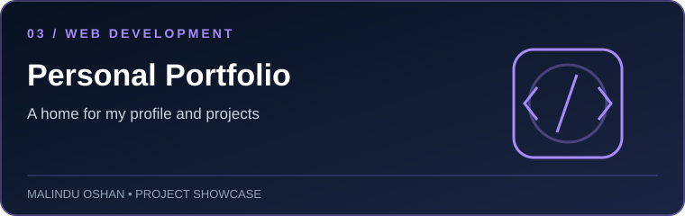
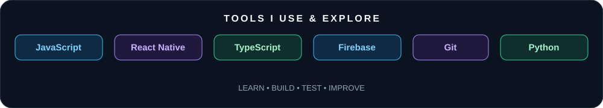
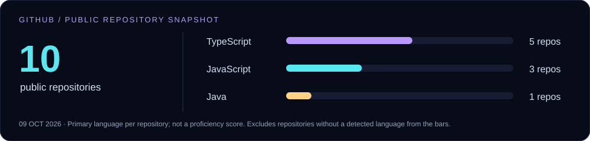

  

  
  
  

  

## Behind the code

<picture>
  <source media="(max-width: 600px) and (prefers-color-scheme: dark)" srcset="assets/about-dark-mobile.svg" />
  <source media="(max-width: 600px)" srcset="assets/about-light-mobile.svg" />
  <source media="(prefers-color-scheme: dark)" srcset="assets/about-dark.svg" />
  
</picture>

  
<b>About me</b> — readable text version

I'm **Malindu Oshan**, an Information Technology undergraduate at the **University of Moratuwa, Sri Lanka**. I enjoy building practical applications, exploring new technologies, and learning how software can solve real problems.

- 🎓 **Currently working on:** University studies and software projects
- 🔐 **Currently learning:** Cybersecurity and computer networking
- 👨‍💻 **My projects and portfolio:** [malinduoshan.github.io/Malindu](https://malinduoshan.github.io/Malindu/)
- 📝 **Articles:** [Travel Ease Sri Lanka](https://traveleasesrilanka.blogspot.com/)
- 📫 **Email:** [malinduoshan277@gmail.com](mailto:malinduoshan277@gmail.com)
- 📄 **Experience / portfolio:** [View my website](https://malinduoshan.github.io/Malindu/)
- ♟️ **Hobby:** I love to play chess

I'm interested in improving my software development skills through hands-on projects and learning more about cybersecurity and networking.

[Email](mailto:malinduoshan277@gmail.com) · [LinkedIn](https://www.linkedin.com/in/malindu-oshan-b6a38924b/) · [GitHub](https://github.com/MalinduOshan)

## Selected projects

**Ideas into applications.** A selection of projects I am building and learning from.

<table>
  <tr>
    <td width="50%" valign="top">
      
      <h3><a href="https://github.com/MalinduOshan?tab=repositories">PhishGuard</a></h3>
      
A mobile-based phishing detector and cybersecurity awareness application concept, bringing URL analysis together with learning and quiz features.

      
<b>React Native · Expo · JavaScript/TypeScript · URL analysis · Threat-intelligence integrations</b>

      
<a href="https://github.com/MalinduOshan?tab=repositories">Explore repositories ↗</a>

    </td>
    <td width="50%" valign="top">
      
      <h3><a href="https://github.com/MalinduOshan?tab=repositories">VehicAlert</a></h3>
      
A mobile reminder app concept to manage vehicle information and track important document expiry dates with local notifications.

      
<b>React Native · Expo Router · TypeScript · AsyncStorage · Local notifications</b>

      
<a href="https://github.com/MalinduOshan?tab=repositories">Explore repositories ↗</a>

    </td>
  </tr>
  <tr>
    <td width="50%" valign="top">
      
      <h3><a href="https://malinduoshan.github.io/Malindu/">Personal Portfolio</a></h3>
      
My portfolio website for sharing profile information and project work.

      
<b>Web development · HTML · CSS · JavaScript</b>

      
<a href="https://malinduoshan.github.io/Malindu/">Visit website ↗</a>

    </td>
    <td width="50%" valign="top">
      <h3>🧩 More projects</h3>
      
Browse my repositories for additional academic work, experiments, and future projects.

      
<a href="https://github.com/MalinduOshan?tab=repositories">Explore all repositories ↗</a>

    </td>
  </tr>
</table>

  
<b>Inside the engineering</b> — a closer look

  - **PhishGuard:** A mobile-oriented project focused on phishing URL checks and cybersecurity awareness. Detection outcomes depend on the implementation and external service availability.
  - **VehicAlert:** Designed around local vehicle/document data and expiry reminders, with an offline-friendly approach.
  - **Portfolio:** A public place to present my profile and work.

  Repository links above currently point to my GitHub repository list because project-specific repository URLs have not been confirmed in this README. Replace them with direct project links once the public repository names are confirmed.

## My toolkit

<b>THE TOOLS AND TECHNOLOGIES I USE OR EXPLORE</b>

  

  
  
  
  
  
  
  
  
  
  
  
  

  

  <b>Frontend & Mobile</b> · HTML · JavaScript · React · React Native · Expo 
  <b>Programming</b> · C · C# · Java · PHP · Python · TypeScript 
  <b>Databases</b> · MySQL · MongoDB 
  <b>Tools</b> · Git · GitHub · VS Code · Adobe Illustrator 
  <b>Exploring</b> · Cybersecurity · Networking

## GitHub at a glance

  
  

  

  

GitHub statistics are generated by external services and may occasionally be unavailable or delayed.

## What I'm focused on

- Building and improving mobile applications.
- Learning cybersecurity and networking fundamentals.
- Improving code quality, testing, and application reliability.
- Learning through hands-on projects and continuous practice.

## Let's build something useful

Have a project, opportunity, or idea to discuss? Feel free to reach out.

  
  

Built with curiosity. Powered by code. Made in Sri Lanka 🇱🇰

## Contribution arcade

  <picture>
    <source media="(prefers-color-scheme: dark)" srcset="https://raw.githubusercontent.com/MalinduOshan/MalinduOshan/output/github-snake-dark.svg" />
    
  </picture>

The contribution snake is generated by the GitHub Actions workflow included in this repository package.

## Support

  

 

  <i>Thanks for visiting my profile! Keep learning, keep building, and keep exploring. ✨</i>

### 🐍 GitHub Contribution Snake

